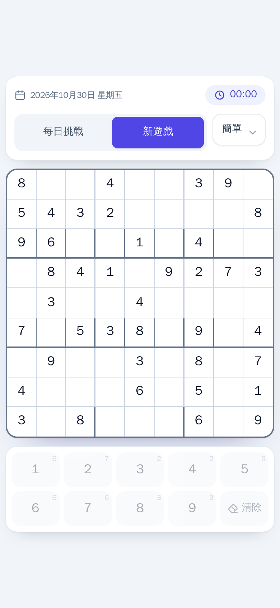
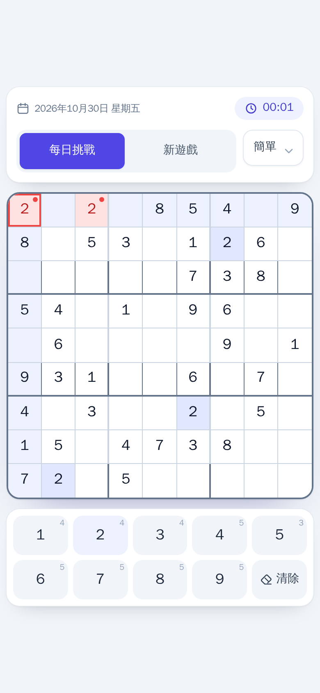
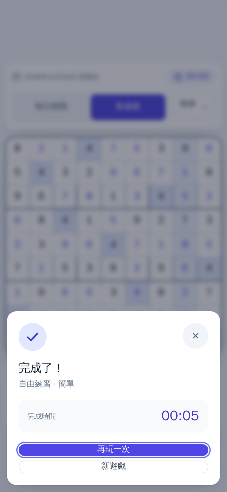
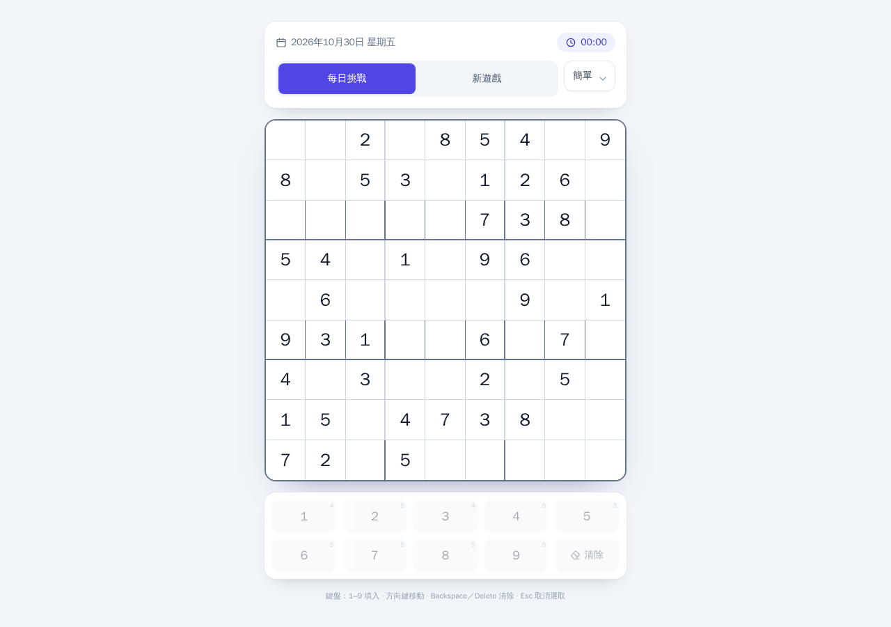

# 數獨 Sudoku PWA

一款**完全離線可玩**的數獨 PWA：每日挑戰、三種難度、行列與九宮格即時錯誤提示，
支援手機安裝到主畫面，電腦端也能用實體鍵盤遊玩。

線上遊玩：<https://shernwu-creator.github.io/sudoku_pwa/>


## 畫面預覽

| 手機版：選取／同列／同數字高亮 | 錯誤提示：違反列、欄或九宮格規則 |
| --- | --- |
|  |  |

| 完成畫面 | 桌面版：置中並限制最大寬度 |
| --- | --- |
|  |  |

## 功能特色

- **100% 離線**：Service Worker 預快取所有 HTML/JS/CSS/圖示，第一次載入後即可飛航模式遊玩。
- **每日挑戰**：以本地日期作為隨機種子，同一天、同一難度在任何裝置都是同一題。
- **三種難度**：簡單 40 個提示、中等 30 個、困難 25 個。
- **即時錯誤提示**：填入數字違反列／欄／3×3 宮規則時，衝突格會以紅色標示。
- **智慧高亮**：選取格、同行、同列、同數字自動高亮，方便推理。
- **手機數字鍵盤**：點格子再點 1–9 即可填入；電腦端支援 1–9、Backspace/Delete/0、
  方向鍵移動、Esc 取消選取。
- **自動存檔**：重新整理或關掉 App 再開，會接續上次進度（每日挑戰跨日自動換題）。
- **PWA 安裝**：支援 Android／iOS「加入主畫面」，standalone 全螢幕體驗。

## 技術棧

| 分類 | 套件 |
| --- | --- |
| 框架 | React 19 + Vite 8 |
| 樣式 | Tailwind CSS 3（Mobile-First） |
| 離線／安裝 | `vite-plugin-pwa`（Workbox 預快取 + Web App Manifest） |
| 每日挑戰 | `seedrandom`（可重現的隨機種子） |
| 樣式工具 | `clsx` + `tailwind-merge`（`cn()`） |
| 測試 | Vitest（純邏輯單元測試） |
| 部署 | GitHub Actions → GitHub Pages |

## 快速開始

需求：Node.js ≥ 20.19（CI 使用 Node 22）、npm。

```bash
npm ci            # 安裝依賴
npm run dev       # 開發模式 http://localhost:5173
npm test          # 執行數獨邏輯單元測試
npm run build     # 正式建置（含 Service Worker 與 manifest）
npm run preview   # 以 GitHub Pages 子路徑驗證 PWA
```

`npm run dev` **不會**啟用 Service Worker（避免 HMR 被快取干擾）。
要驗證離線與安裝功能，請用：

```bash
npm run build
npm run preview
# 開啟 http://localhost:4173/sudoku_pwa/
# DevTools → Application → Service Workers，確認狀態為 activated
# 之後可切換 DevTools Network → Offline 重新整理，遊戲仍可正常遊玩
```

## 專案結構

```text
.
├─ index.html                    # PWA meta、圖示、React 掛載點
├─ vite.config.js                # base path、VitePWA manifest / Workbox 設定
├─ vitest.config.js              # 邏輯測試設定（node 環境）
├─ tailwind.config.js            # 品牌色、陰影、動畫
├─ src/
│  ├─ main.jsx                   # React 掛載 + Service Worker 註冊
│  ├─ index.css                  # Tailwind 入口 + 安全區 utilities
│  ├─ App.jsx                    # 版面組合、全域鍵盤、勝利畫面
│  ├─ components/
│  │  ├─ Header.jsx              # 日期、難度、新遊戲／每日挑戰、計時器
│  │  ├─ Board.jsx               # 9×9 棋盤與各式高亮
│  │  ├─ NumberPad.jsx           # 手機數字鍵盤
│  │  └─ WinDialog.jsx           # 完成畫面
│  ├─ hooks/
│  │  └─ useSudokuGame.js        # 遊戲狀態機、計時、localStorage 存檔
│  └─ utils/
│     ├─ sudokuLogic.js          # 生成／挖洞／驗證（純函式，可獨立測試）
│     ├─ sudokuLogic.test.js     # Vitest 單元測試
│     ├─ date.js                 # 本地日期 key（每日挑戰種子）
│     └─ cn.js                   # clsx + tailwind-merge
├─ scripts/generate-icons.mjs    # 純 Node.js 產生 PWA 圖示
├─ public/                       # favicon、PWA 圖示
├─ docs/screenshots/             # README 用的實際畫面截圖
└─ .github/workflows/deploy.yml  # GitHub Pages 自動部署
```

## 數獨演算法

`src/utils/sudokuLogic.js` 與 UI 完全解耦，可單獨測試：

- `generateSudoku(seed)`：以 `seedrandom` 建立本次呼叫專屬的隨機函式，用
  Fisher–Yates 洗牌搭配**回溯法 (backtracking)** 產生完整合法盤面。
  相同 `seed` 一定得到相同盤面；不傳 `seed` 時才使用 `Math.random`。
- `createPuzzle(board, difficulty, seed)`：從完整盤面隨機「挖洞」直到提示數精確為
  40／30／25，並保留原盤面的數字值；相同 `seed` + 難度可重現，因此每日挑戰能跨裝置一致。
  挖洞時會用有限節點預算的求解器盡量維持唯一解（easy／medium 實測皆唯一；
  hard 為確保精確 25 個提示，極少數題目可能有多解，不影響本遊戲以行列／宮衝突判定完成的方式）。
- `checkValidity(board, row, col, num)`：檢查列、欄、3×3 宮是否衝突（忽略該格本身）。
- `getConflicts(board)`：回傳所有參與重複的格子，供 UI 紅色高亮。
- `isComplete(board)`：盤面填滿且無衝突即完成。

每日挑戰的種子格式為 `daily-YYYY-MM-DD`（本地時間），再衍生出盤面與挖洞用的種子；
「新遊戲」則使用隨機種子，並一併寫入 localStorage 以便下次接續。

## 部署（GitHub Pages）

推送到 `main` 後，GitHub Actions 會自動：

1. `npm ci` → `npm test` → `npm run build`（`VITE_BASE_PATH=/sudoku_pwa/`）；
2. 以 `actions/configure-pages` / `upload-pages-artifact` / `deploy-pages` 發佈到 Pages。

Repo 的 **Settings → Pages → Build and deployment → Source** 需設為
**GitHub Actions**（本專案已設定）。本機若要用自訂網域或根路徑部署，可覆寫：

```bash
VITE_BASE_PATH=/ npm run build
```

> GitHub Pages 專案站台固定位於 `https://<user>.github.io/<repo>/`，
> 因此 `base`、manifest 的 `start_url`／`scope`／icons 都依賴 `VITE_BASE_PATH`。

## 開發規範與 AI 代理

本 repo 已建立 **CodeGraph** 代碼圖譜（`.codegraph/`，已加入 `.gitignore`）。
所有 AI 代理在探索或修改前，請先讀 [`AGENTS.md`](AGENTS.md)：

- 優先用 `codegraph explore` / `codegraph query` / `codegraph impact` 定位符號，
  再用 `read` 讀取具體行號；禁止對整個 repo 大範圍 `grep`／`ripgrep`／`find`，
  也禁止一次讀整個 `src/`、`node_modules/`、`dist/`。
- 修改後執行 `codegraph sync`（或 `npm run codegraph:sync`）維持圖譜最新。

```bash
codegraph status
codegraph explore "每日挑戰種子如何傳入生成器"
codegraph impact createPuzzle
```

## 授權

本專案為個人練習作品，可自由參考與修改。
